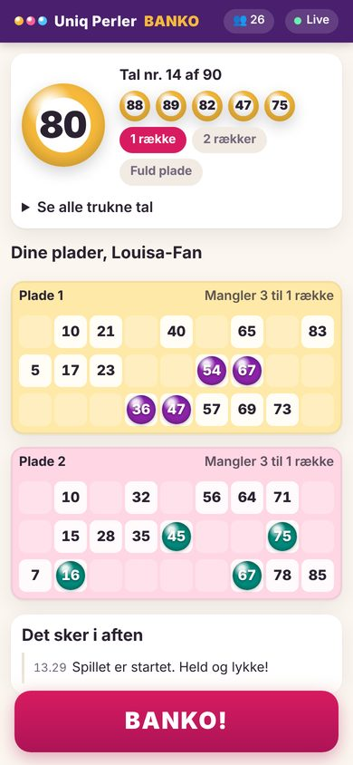
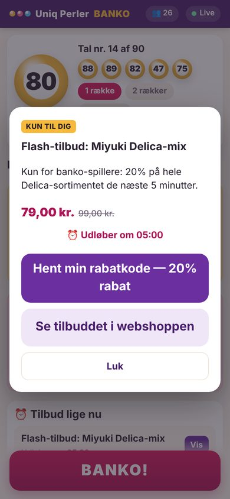
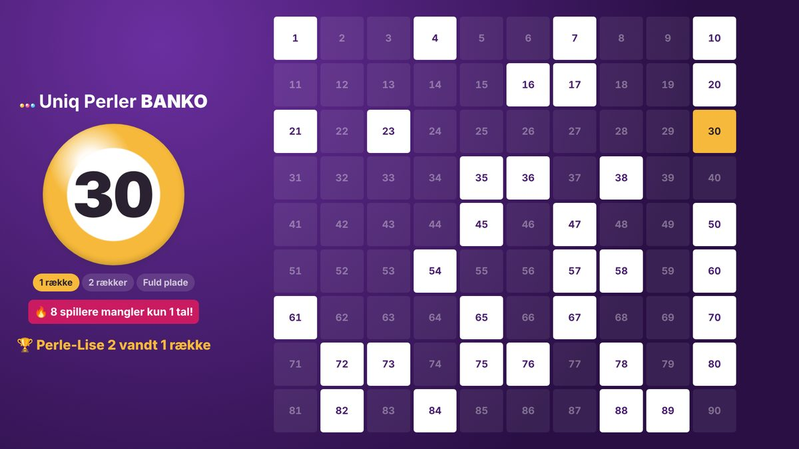
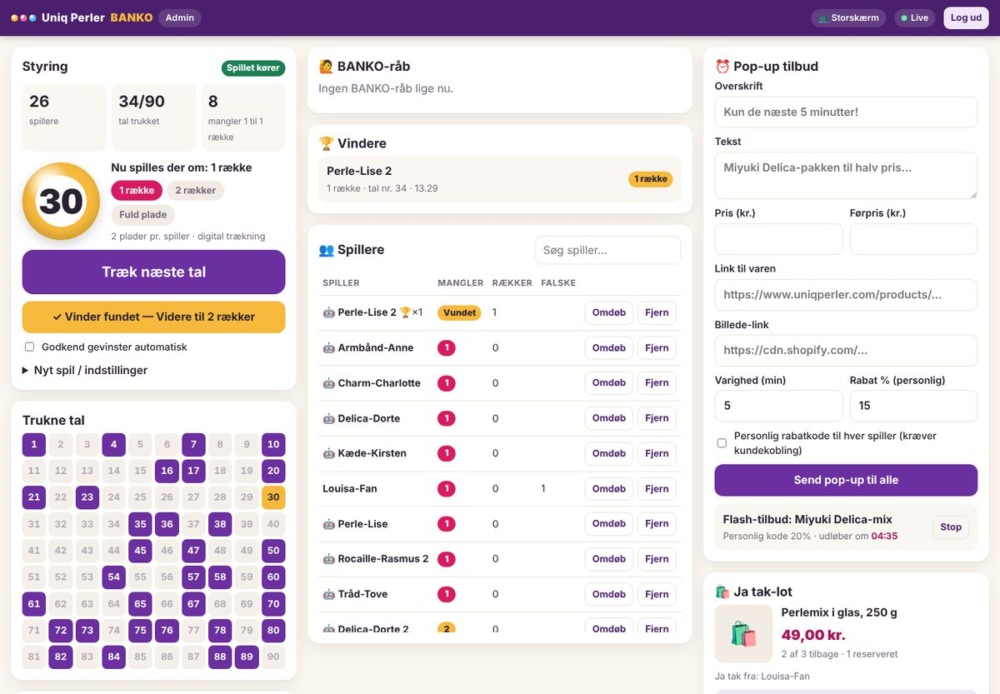

# Uniq Perler Banko (prototype)

Live-banko for Uniq Perlers kunder. Kunderne spiller med hjemmefra på mobilen. I styrer spillet fra et admin-panel, gerne mens I sender live på Facebook og Instagram.

| Kunde (mobil) | Tidsbegrænset tilbud | Storskærm / OBS |
|---|---|---|
|  |  |  |



## Hvad kan den?

**Kundevisning** (`/`)
- Kunden vælger selv et brugernavn. Navnet tjekkes for længde, tegn og grimme ord og må ikke være taget i forvejen.
- Kunden får 1-6 rigtige danske bankoplader: 3 rækker × 9 kolonner, 15 tal, kolonnerne 1-9, 10-19 … 80-90.
- Tallene markeres automatisk som små glasperler. Kunden kan også slå det fra og markere selv ("tusch-tilstand").
- Kunden kan se, hvor mange tal hver plade mangler til den aktuelle gevinst: 1 række, 2 rækker eller fuld plade.
- Der er en stor BANKO!-knap, som pulserer, når kunden har gevinst.
- "Læs tallene højt" (dansk tale) og "Større tekst", så det også er nemt for de ældre perlevenner.
- Tidsbegrænsede pop-up-tilbud med nedtælling og evt. personlig rabatkode.
- "Ja tak"-lots som i onsdagsliven: én knap reserverer varen, og så ligger den i kundens **banko-kurv** med nedtælling.

**Admin** (`/admin`, beskyttet med kodeord)
- Start spillet, og træk tal digitalt eller tast tallene fra en fysisk tromle ind. Der er også en fortryd-knap til tastefejl.
- Live-liste over alle spillere, sorteret efter hvem der er tættest på gevinst ("mangler 1", "mangler 2" …).
- BANKO-råb kommer ind i en kø. Serveren har allerede tjekket pladen, så I trykker bare **Godkend**.
- Spillere, der *har* gevinst men ikke har trykket, bliver også vist, så ingen går glip af en præmie.
- Godkendelse kan også ske helt automatisk.
- Send pop-up-tilbud til alle, og åbn/luk "Ja tak"-lots med lagerantal, maks pr. kunde og reservationstid.
- Spillere kan omdøbes eller fjernes. Der er også en knap til testspillere (bots), så I kan øve jer.

**Storskærm** (`/skaerm`): stor kugle, tavle med 1-90, "8 spillere mangler kun 1 tal!" og seneste vinder. Den kan lægges direkte ind i OBS som *Browser source* til livestreamen.

## Kom i gang

Kræver kun Node.js 20+. Der er ingen eksterne pakker.

```bash
cd banko
ADMIN_PASSWORD='vælg-et-langt-kodeord' npm start
# Spillere:  http://localhost:3000/
# Admin:     http://localhost:3000/admin
# Skærm:     http://localhost:3000/skaerm
npm test     # 29 tests: regler, sikkerhed, Shopify-signaturer og hele forløbet over HTTP
```

Uden Shopify-opsætning kører appen i **demo-tilstand**. Alt virker, men rabatkoder og kurve oprettes ikke i webshoppen.

## Sikkerhed — hvorfor man ikke kan snyde

- **Serveren bestemmer alt.** Den laver pladerne, trækker tallene og tjekker hvert BANKO-råb. Det kunden markerer på skærmen, er kun pynt.
- **Kunden ser kun sine egne plader.** Andres plader og de kommende tal sendes aldrig til browseren. Det har vi tests for.
- **Ingen "pladeshopping".** Tilmeldingen lukker, når første tal er trukket. Ellers kunne man oprette nye spillere, indtil man fik en plade med mange trukne tal.
- **Én spiller pr. kundekonto**, når Shopify-koblingen er slået til.
- **Falske BANKO-råb tælles.** Efter 3 kan man ikke råbe mere i det spil.
- **Fair trækning (provably fair).** Ved digital trækning låses rækkefølgen af alle 90 tal, før spillet starter. Kunderne kan se et SHA-256-fingeraftryk af den, og nøglen vises, når spillet er slut. Alle kan efterregne med `npm run verify-draw -- <seed> <hash>`. Ikke engang admin kan se de kommende tal.
- Signerede tokens (HMAC) i `Authorization`-headeren i stedet for cookies, så der ikke er CSRF.
- Admin-kodeordet sammenlignes i konstant tid, og alle indgange er rate-limited: login, tilmelding, BANKO og Ja tak.
- Streng Content-Security-Policy: kun egne scripts, ingen inline-kode, `frame-ancestors 'none'`.
- Brugerdata indsættes aldrig som HTML. Links i tilbud skal være `https://`.
- Mappen `data/` indeholder spillets hemmelige seed og token-nøglen. Den må ikke lægges offentligt eller i git (den står i `.gitignore`).

## Kobling til kundens Uniq Perler-konto

**Ja, det kan lade sig gøre**, og det er den sikreste måde at vide, hvem der spiller. Vi bruger Shopifys **App Proxy**:

1. Kunden åbner `uniqperler.com/apps/banko`, mens hun er logget ind i webshoppen.
2. Shopify sender kaldet videre til banko-serveren (`/proxy`) med kundens id (`logged_in_customer_id`) og en HMAC-signatur, som kun Shopify og vi kender nøglen til.
3. Serveren tjekker signaturen og sender kunden videre til spillet med et login-link, som udløber efter 10 minutter og kun kan bruges én gang. Er kunden ikke logget ind, sendes hun til login først.
4. Brugernavnet huskes til næste gang.

Opsætning:
1. Opret en app til butikken i Shopifys **Dev Dashboard** (dev.shopify.com → Apps → Create app).
2. Slå **App proxy** til: præfiks `apps`, sti `banko`, URL `https://<banko-domæne>/proxy`.
3. Giv app'en adgangene `write_draft_orders` og `write_discounts`, og installér den på butikken.
4. Sæt `SHOPIFY_SHOP`, `SHOPIFY_CLIENT_ID` og `SHOPIFY_APP_SECRET` (app'ens client ID og client secret). Serveren henter og fornyer selv sit adgangstoken. Vil I kræve kundekonto for at spille med, så sæt også `REQUIRE_SHOPIFY_LOGIN=1`.

## "Ja tak" med reservation (som Sprii)

Vi kan ikke se præcis, hvordan Sprii har bygget det. Men Shopify har selv byggeklodserne: en **kladdeordre (draft order) med `reserveInventoryUntil`**.

- Når en logget-ind kunde siger "Ja tak" til et lot med Shopify variant-ID, opretter serveren én samlet kladdeordre til hende. Den har live-prisen og er tagget `banko`. Næste "Ja tak" samme aften lægges på den samme ordre.
- Varen **trækkes fra det disponible lager**, indtil reservationen udløber (standard 48 timer). Ingen andre kan købe den imens.
- Kunden får et **betalingslink** direkte i appen. Det passer fint med Samle Ordre.
- Udløber reservationen, frigiver Shopify lageret automatisk, og appen lægger varen tilbage i lottet.

## Personlige tilbud

Admin kan sende et tilbud med **personlig rabatkode**. Når kunden trykker "Hent min rabatkode", oprettes en kode i Shopify med disse regler:
- den virker kun for hende og kun én gang
- den udløber 15 minutter efter tilbuddet

Koderne oprettes kun for dem, der faktisk trykker. Så er der ingen spam af tusindvis af koder.

**Anbefaling ud fra købshistorik** (næste skridt): Når kontoen er koblet på, kan serveren slå kundens seneste ordrer op via Admin API. Derefter kan den finde passende varer med Shopifys egne anbefalinger (`productRecommendations` med `COMPLEMENTARY`, "Pair it with") og fjerne dem, hun allerede har købt. Det kræver de samme byggeklodser og er ikke lavet endnu.

## ⚠️ Juridisk: gratis spil + frivillige tilbud

Et spil kræver tilladelse fra Spillemyndigheden, når der både er **indsats**, **præmie** og **tilfældighed**. Spil, hvor man ikke betaler for at deltage, kræver ikke tilladelse. Frivillige tilbud under spillet ændrer ikke på det, så længe købet ikke hænger sammen med spillet. Hold disse regler:

1. **Alle spiller gratis og på lige vilkår.** Samme antal plader til alle, uanset om man køber noget.
2. **Køb må aldrig give fordele i spillet**: ingen ekstra plader, ingen ekstra chancer, ingen "kun for kunder der har købt".
3. **Præmien må ikke kræve et køb.** Giv fx en perlepakke sendt gratis eller et gavekort. Undgå "rabatkode" som præmie, for den kræver et køb for at have værdi.
4. **Tilbuddene er almindelig markedsføring** ved siden af spillet. Appen skriver selv "Det er gratis at spille med" ved tilmelding og "Køb er frivilligt og påvirker ikke dine chancer i banko" ved tilbud og lots.

**Afgift af præmier:** Gratis spil med præmier kan være afgiftspligtige. Arrangøren betaler 17,5 % af den del af præmien, der overstiger 750 kr. for varepræmier og 200 kr. for kontantpræmier. Holder I hver præmie under de grænser, er der ingen afgift. Ellers skal I registreres hos Skattestyrelsen og betale afgiften. Vinderen skal ikke betale skat af præmien. Tjek de aktuelle satser hos Skattestyrelsen.

Skriv korte spilleregler (hvem kan deltage, præmier, hvordan vindere findes og kontaktes), og få modellen bekræftet skriftligt af Spillemyndigheden før premieren.

Kobling af konto og brug af købshistorik til tilbud er behandling af persondata. Nævn det i jeres privatlivspolitik og i spillets betingelser.

## Hosting på Railway

Banko kører som sin **egen service** i det Railway-projekt, hvor I allerede har jeres app. Så kan en fejl i banko aldrig vælte den anden app og omvendt.

1. **Ny service:** I projektet: *+ Create → GitHub Repo →* vælg repoet med `banko/`.
2. **Settings → Source:** *Root Directory* `/banko`. Sæt *Config file path* til `/banko/railway.json`, for config-filen følger ikke Root Directory. Den giver start-kommando, healthcheck (`/healthz`) og genstart ved fejl.
3. **Volume:** Højreklik på servicen → *Attach volume*, mount path `/data`. Appen finder selv volumet via `RAILWAY_VOLUME_MOUNT_PATH`, og spillet overlever dermed redeploys.
4. **Variables:** `ADMIN_PASSWORD` (mindst 12 tegn, ellers starter appen ikke) og `SESSION_SECRET` (en lang tilfældig streng). Shopify-variablerne kommer senere.
5. **Networking:** *Generate Domain*, eller tilføj fx `banko.uniqperler.com` som custom domain og sæt `PUBLIC_ORIGIN=https://banko.uniqperler.com`.

Det klarer appen selv på Railway:
- lytter på `0.0.0.0` og Railways `PORT`
- bruger `RAILWAY_PUBLIC_DOMAIN` som adresse, indtil `PUBLIC_ORIGIN` er sat
- slår HTTPS-headers (HSTS) til
- rate-limiter på kundens rigtige IP (`X-Real-IP`)

**Godt at vide:**
- **Lange forbindelser:** Railway lukker forbindelser efter 15 minutter. Appen genforbinder straks og henter hele spillets tilstand igen, så kunderne mærker det ikke.
- **Redeploy:** En service med volume har et kort udfald ved hver redeploy. Appen gemmer spillet ved nedlukning, og kunderne kommer automatisk tilbage. **Undgå alligevel at deploye under en live-aften.**
- **Én instans:** Med volume kører servicen som én instans (ingen replicas). Det rækker til mange tusinde samtidige spillere.

## Vejen fra prototype til drift

- **Hosting:** Se "Hosting på Railway" ovenfor. Andre steder: kør bag HTTPS med en fast disk til `data/`, og sæt `NODE_ENV=production`, `TRUST_PROXY=1` og `PUBLIC_ORIGIN`.
- **Betaling og status:** Tilføj Shopify-webhooks (`orders/create`, `draft_orders/update`), så en reservation vises som "betalt" i admin.
- **Mange spillere (5.000+):** Flyt tilstanden til Redis eller Postgres, og send kun ændringer i stedet for hele tilstanden ved hvert tal.
- **Præmier:** Eksportér vindere med kunde-id, eller udsted automatisk et gavekort til vinderen.

## Miljøvariabler

| Variabel | Betydning |
|---|---|
| `ADMIN_PASSWORD` | Admin-kodeord (min. 12 tegn i produktion). Uden det genereres et midlertidigt kodeord, som vises i loggen. |
| `PORT`, `HOST` | Standard `3000` / `127.0.0.1` (`0.0.0.0` i produktion og på Railway). |
| `PUBLIC_ORIGIN` | Den offentlige adresse, fx `https://banko.uniqperler.com` (på Railway: `RAILWAY_PUBLIC_DOMAIN`, hvis ikke sat). |
| `SESSION_SECRET` | Nøgle til tokens (ellers genereres en og gemmes i `data/`). |
| `DATA_DIR` | Hvor spillet gemmes (standard: Railway-volumet, ellers `./data`). |
| `TRUST_PROXY=1` | Brug `X-Real-IP`/`X-Forwarded-For` til rate limiting bag en proxy (slået til automatisk på Railway). |
| `SHOPIFY_SHOP` | `uniqperler.myshopify.com` |
| `SHOPIFY_CLIENT_ID` | App'ens client ID fra Dev Dashboard. |
| `SHOPIFY_APP_SECRET` | App'ens client secret. Bruges til at verificere app proxy-kald og til at hente adgangstoken. |
| `SHOPIFY_ADMIN_TOKEN` | Alternativ til client ID: et fast Admin API-token (`shpat_…`), hvis I har en ældre custom app. |
| `SHOPIFY_API_VERSION` | Standard `2026-10`. |
| `SHOP_URL` | Webshoppens adresse, bruges til login-redirect. Standard `https://www.uniqperler.com`. |
| `REQUIRE_SHOPIFY_LOGIN=1` | Kun kunder med konto kan spille. |

## Filer

```
server.js            HTTP-server, ruter, live-opdateringer (SSE), Shopify-synk
railway.json         Railway: start-kommando, healthcheck og genstartspolitik
src/game.js          Spillets regler og tilstand
src/plates.js        Generering og tjek af bankoplader
src/fair.js          Fair trækning (seed → rækkefølge af 1-90)
src/auth.js          Tokens, konstant-tids-sammenligning, rate limiting
src/shopify.js       App proxy-verifikation, kladdeordrer, rabatkoder
src/usernames.js     Validering af brugernavne
public/              Kunde-, admin- og storskærm (ren HTML/CSS/JS)
test/                Tests (node --test)
```
