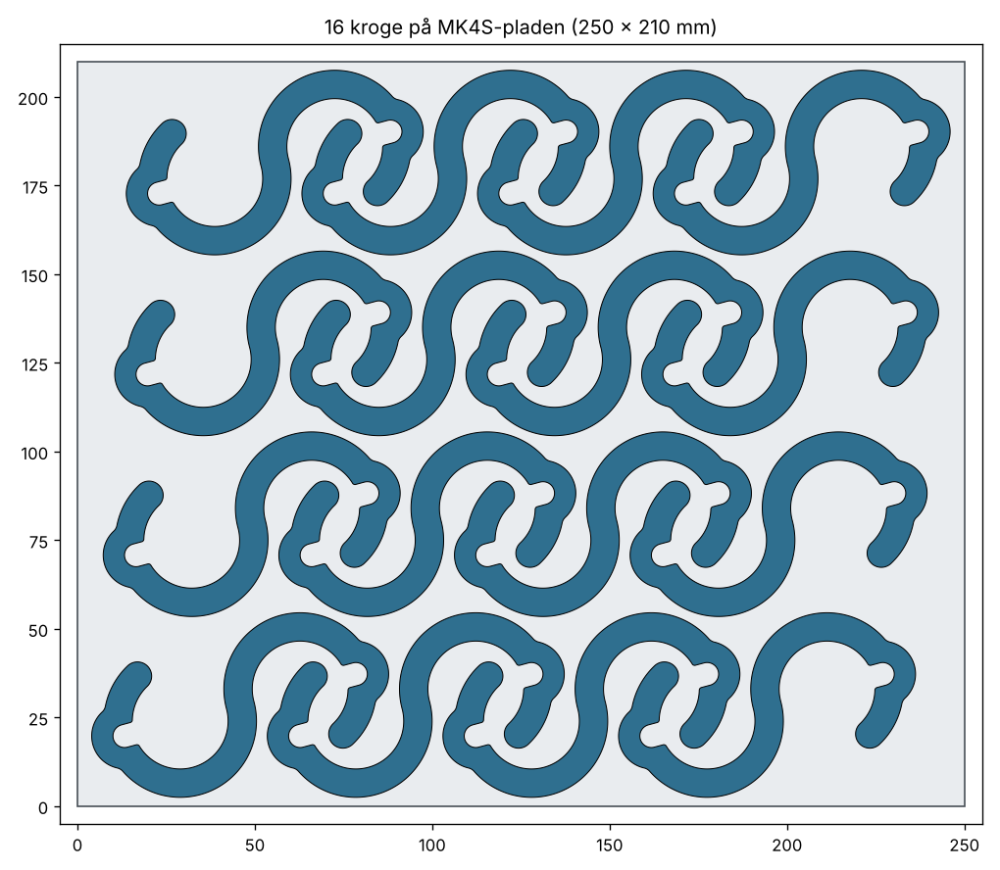

# Perle-krog v3 (S-krog med klik-lås) til stativstangen og perlenettet

S-krog til vores stativstang (**Ø 22,2 mm**, målt med skydelære) **og** perlenettet (**rionet med
5 mm tråd**). Den øverste ring går om stangen eller tråden, og bundterne hænger i den nederste ring.

**Nyt i v3:**

- **Klik-lås, så krogene ikke hopper af.** Åbningen ind i ringen er **20,5 mm**, altså smallere
  end stangen (22,2 mm). Krogen klikkes på stangen og skal trækkes af med vilje. Et bump, når
  stativet køres, kan ikke ryste den af: bunden af ringen er lukket, og åbningen vender til siden.
- **Begge ender er ens.** Samme store ring og åbning i begge ender, så det er ligegyldigt, hvilken
  vej krogen hænges op.
- **Hænger lige.** Ringene sidder lodret over hinanden, så krogen hænger lodret i stedet for skævt.
- **Virker også på perlenettet.** Øverst i hver ring er en **tråd-lomme** (6,5 mm bred, 6 mm dyb).
  Rionet-tråden (5 mm) falder selv op i lommen, når krogen hænger. Krogen skal løftes ca. 6 mm og
  flyttes til siden for at komme af tråden. Stangen (22,2 mm) hviler bare hen over lommen, så
  klik-låsen virker som før.

Krogen findes i **PLA** og **PETG** med **præcis samme form**. Den eneste forskel er teksten på
ringen, så man altid kan se, hvilket materiale krogen er lavet af.

| PLA | PETG |
|---|---|
|  |  |

---

## Nøgletal

| | PLA | PETG |
|---|---|---|
| Størrelse | 43 × 86 × 7 mm | 43 × 86 × 7 mm |
| Profil (bredde × tykkelse) | 8 × 7 mm | 8 × 7 mm |
| Ringe (begge ender) | Ø 27 mm indv., åbning 20,5 mm | Ø 27 mm indv., åbning 20,5 mm |
| Klik-lås | 1,7 mm (stang 22,2 mm gennem 20,5 mm åbning) | samme |
| Tråd-lomme (rionet) | 6,5 mm bred, 6 mm dyb | samme |
| Mærke | "PLA" præget 0,6 mm ned i ringen | "PETG" præget 0,6 mm ned i ringen |
| Vægt | ca. 7,9 g | ca. 8,1 g |
| Printtid, 1 stk (MK4S) | ca. 16 min | ca. 17 min |
| Printtid, 16 stk (fuld plade) | ca. 4 t 20 min, 127 g | ca. 4 t 30 min, 130 g |
| Brud (beregnet) | ca. 15 kg | ca. 12–15 kg |
| **Hæng max** | **ca. 4 kg** | **ca. 4 kg** (tåler konstant last bedre end PLA) |

**PLA vs. PETG:** Begge kroge er bygget til ca. 4 kg. PETG er sejere: overbelastes den, bøjer den,
før den knækker, og den kryber mindre under konstant vægt og varme. Klik-låsen er også blødest og
mest holdbar i PETG. PLA er sprødt og bliver blødt ved ca. 55 °C, så hæng ikke PLA-kroge i direkte sol.

## Sådan bruges den

- **På stangen:** Hold krogen, så åbningen i den ene ring vender mod stangen, og tryk den på,
  til den klikker. Lad den så hænge.
- **Af stangen:** Drej krogen, så åbningen vender væk fra dig, og træk den af med et fast ryk.
- **På perlenettet (rionet):** Før en vandret tråd ind gennem åbningen i ringen og lad krogen
  hænge. Tråden glider selv op i lommen i toppen af ringen. Krogen hænger ud på begge sider af
  nettet, så der skal være ca. 22 mm fri plads bag tråden (hvis nettet sidder op ad en væg).
- **Bundter:** Før løkken/snoren ind gennem åbningen i den nederste ring. Den glider let ind,
  fordi snore er tynde. Den hænger i bunden af ringen (i lommen), og spidsen holder den inde.

---

## Klar til print på MK4S (åbn og print)

PrusaSlicer-projekter med krogene placeret på pladen og alle indstillinger gemt i filen:

| Fil | Indhold | Tid | Filament |
|---|---|---|---|
| `print/perle_krog_PLA_MK4S_1stk.3mf` | 1 PLA-krog | ca. 16 min | 7,9 g |
| `print/perle_krog_PLA_MK4S_16stk.3mf` | fuld plade, 16 PLA-kroge | ca. 4 t 20 min | ca. 127 g |
| `print/perle_krog_PETG_MK4S_1stk.3mf` | 1 PETG-krog | ca. 17 min | 8,1 g |
| `print/perle_krog_PETG_MK4S_16stk.3mf` | fuld plade, 16 PETG-kroge | ca. 4 t 30 min | ca. 130 g |

Den fulde plade er det højeste antal, der kan være på pladen med ca. 3 mm luft mellem krogene.
Tiderne er uden opvarmning og bed-måling (ca. 3–5 min ekstra).

**Indstillinger i filerne:**

| | PLA | PETG |
|---|---|---|
| Printer | `Original Prusa MK4S 0.4 nozzle` | `Original Prusa MK4S 0.4 nozzle` |
| Print | `0.20mm SPEED @MK4S 0.4` | `0.20mm SPEED @MK4S 0.4` |
| Filament | `Generic PLA` | `Generic PETG` |
| Dyse | 230 °C første lag, derefter 220 °C | 240 °C |
| Bed | 60 °C | 85 °C første lag, derefter 90 °C |
| Perimetre / top / bund | **5 / 4 / 4** | **5 / 4 / 4** |

Perimetre og top/bund-lag er sat direkte på krogen, så de bliver, selvom man skifter print- eller
filamentprofil. Infill er ligegyldigt, fordi krogen næsten er massiv. Ingen support og ingen brim.

**Sådan:** Åbn filen i PrusaSlicer (Fil → Åbn projekt). Spørger den, om indstillingerne fra projektet
skal indlæses, så svar ja. Tryk **Slice** og send til printeren.
Har I en High-Flow-dyse, så vælg printerprofilen `MK4S HF0.4`. Krog-indstillingerne følger med.

### Printpladen

PETG hæfter **meget** godt. På en **glat PEI-plade** skal der lim-stift på som slip-lag, ellers kan
PETG rive stykker af belægningen, når krogene tages af. På en **teksturet eller satin-plade**
(standardpladen til MK4S er den matte satin-plade) skal der ikke lim på.

- Rengør pladen med isopropylalkohol (IPA) før print, og tag ikke på printfladen med fingrene.
  Vask den en gang imellem med opvaskemiddel og varmt vand. **Aldrig acetone** (giver mikrorevner).
- Lad pladen køle helt af, før krogene tages af. Tag pladen af og bøj den let, så springer de af.
  Brug ikke skarpe metalskrabere.
- Den fulde plade går helt ud til kanterne, så rengør hele pladen.

### Test først

1. **Klik-test:** Print 1 krog og klik den på stangen et par gange. Den skal klikke tydeligt på og
   kræve et fast ryk at få af. Er den for stram eller for løs, så se `snap_gap` herunder.
   Hæng den også på perlenettet og tjek, at tråden ligger i lommen.
2. **Belastning:** Hæng **8 kg** (dobbelt last) på én test-krog i et døgn (fx en pose perler eller
   vandflasker). Holder den uden at åbne sig synligt, er I godt dækket ind med 4 kg i daglig brug.
   Brug ikke test-krogen bagefter.

---

## Filer

| Fil | Hvad |
|-----|------|
| `perle_krog_PLA.stl` | PLA-krogen ("PLA" på ringen). 1 krog, ligger fladt. |
| `perle_krog_PETG.stl` | PETG-krogen ("PETG" på ringen). 1 krog, ligger fladt. |
| `perle_krog.scad` | Modellen (OpenSCAD). Vælg `variant` øverst i filen. |
| `print/` | Klar-til-print PrusaSlicer-projekter (3MF) med indstillinger. |
| `renders/` | Preview-billeder. |

## Print selv fra STL (andre printere)

- **Orientering:** fladt, som STL'en ligger. **Ingen support.** Så følger laglinjerne krogens
  form, og både belastningen og klik-fjedringen går *langs* perimetrene.
- **Lag:** 0,2 mm
- **Perimetre: 5.** Det er det vigtigste, fordi krogen så bliver massiv.
- **Top/bund:** 4 lag

---

## Justering (i `perle_krog.scad`)

| Parameter | Værdi | Hvad |
|---|---|---|
| `variant` | `"PETG"` / `"PLA"` | Vælger teksten på ringen. Formen er den samme. |
| `rod_d` | 22,2 | Stangens diameter. Mål en anden stang og skriv tallet her. |
| `snap_gap` | 20,5 | Åbningen ind i ringene. **For stram at klikke på: 21. For løs: 20.** |
| `ring_d` | 27 | Ringenes indvendige Ø. |
| `wire_slot_w` | 6,5 | Tråd-lommens bredde (rionet-tråd 5 mm). |
| `wire_slot_d` | 6 | Tråd-lommens dybde = hvor meget krogen skal løftes for at komme af tråden. |
| `wall` | 8 | Godsbredde. Styrken stiger med bredden i anden potens. |
| `thick` | 7 | Krogens tykkelse (printhøjde). Styrken stiger lineært. |
| `label` | = `variant` | Tekst præget i ringen. |

Åbn filen i OpenSCAD, ret tallet, tryk **F6** (render) og **F7** (eksportér STL).
Konsollen viser åbning, klik-lås og krogens mål.
Fra kommandolinjen: `openscad -D 'variant="PETG"' -o perle_krog_PETG.stl perle_krog.scad`.
