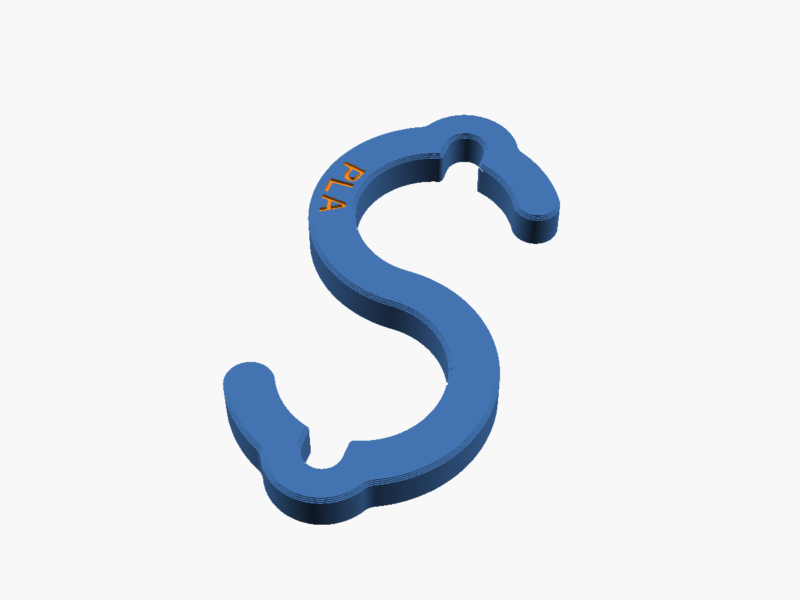
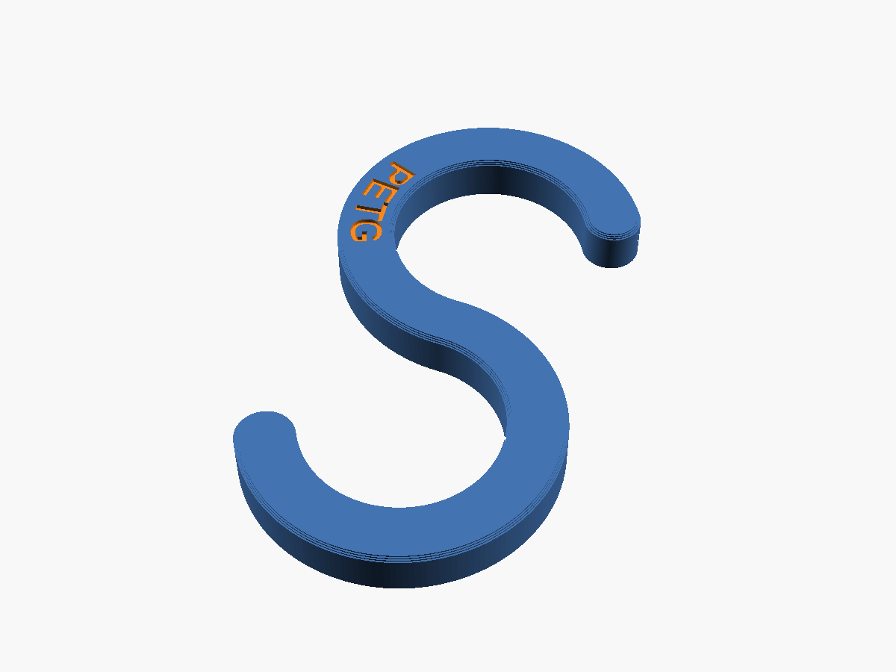
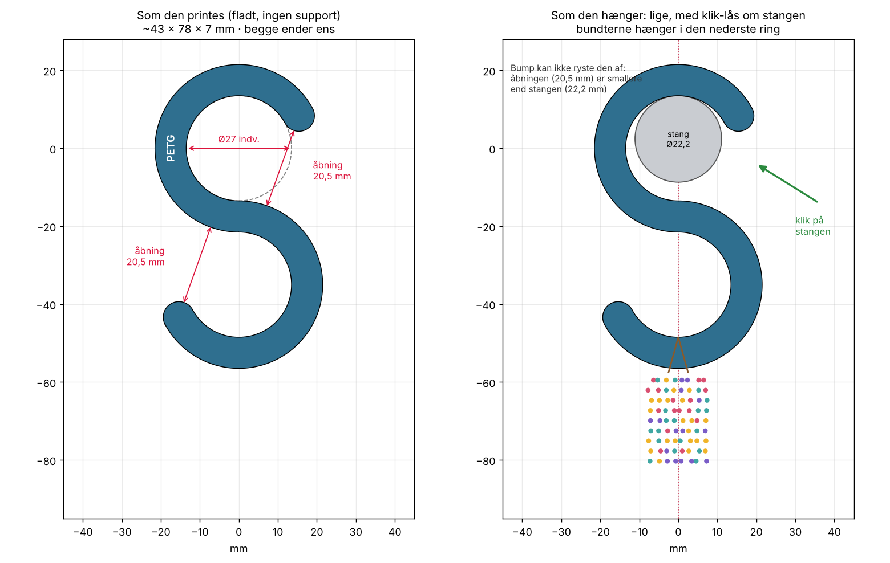
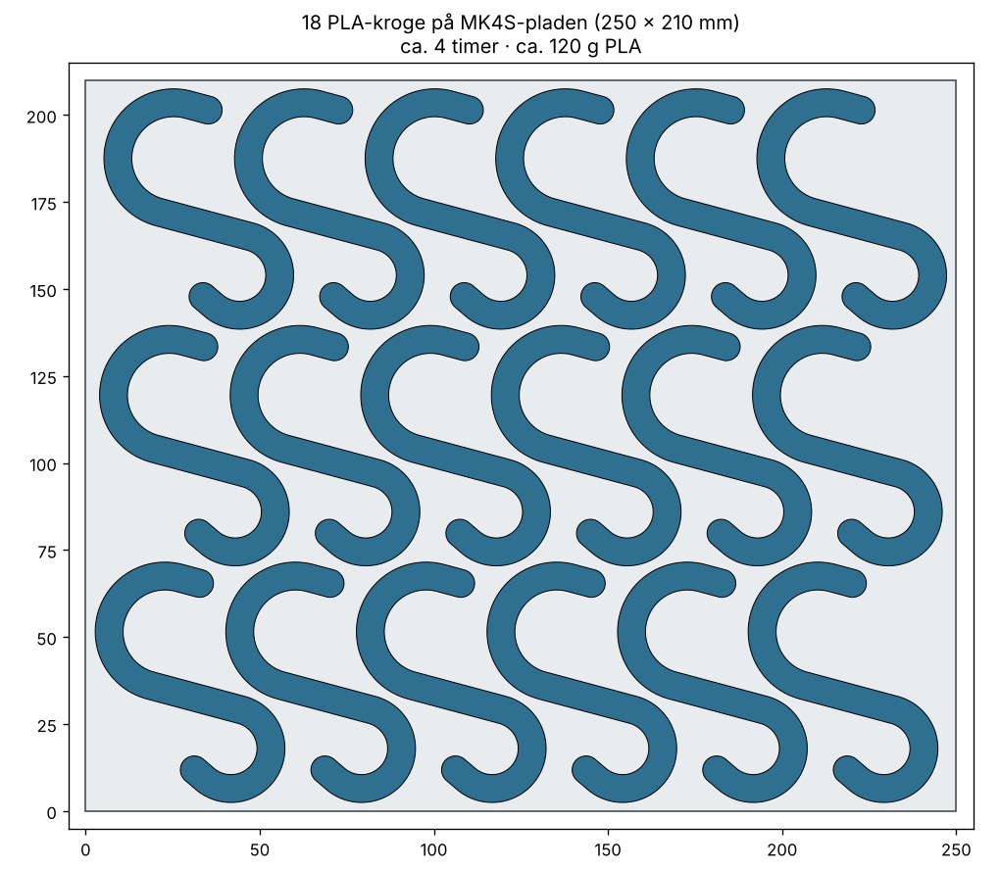

# Perle-krog (S-krog) til stativstangen

S-krog i stil med IKEA's, lavet til vores stativstang (**Ø 22,2 mm**, målt med skydelære).
Den store top-krog går om stangen, og hagen forneden holder perlebundterne. Åbningen ind i hagen
er ca. 12 mm, ligesom butikkens metal-kroge (målt 12,4–12,6 mm).

Krogen findes i **PLA** og **PETG** med **præcis samme form**. Den eneste forskel er teksten i
skaftet, så man altid kan se, hvilket materiale krogen er lavet af.

| PLA | PETG |
|---|---|
|  |  |

---

## Nøgletal

| | PLA | PETG |
|---|---|---|
| Størrelse | 63 × 63 × 7 mm | 63 × 63 × 7 mm |
| Profil (bredde × tykkelse) | 8 × 7 mm | 8 × 7 mm |
| Top-krog (om stangen) | Ø 24 mm indv. (1,8 mm luft) | Ø 24 mm indv. (1,8 mm luft) |
| Hage (til bundter) | Ø 15 mm indv., åbning ca. 12 mm | Ø 15 mm indv., åbning ca. 12 mm |
| Mærke | "PLA" præget 0,6 mm ned i skaftet | "PETG" præget 0,6 mm ned i skaftet |
| Vægt | ca. 6,7 g | ca. 6,9 g |
| Printtid, 1 stk (MK4S) | ca. 13 min | ca. 14 min |
| Printtid, 18 stk (fuld plade) | ca. 4 t, 120 g | ca. 4 t 10 min, 122 g |
| Brud (beregnet) | ca. 15 kg | ca. 12–15 kg |
| **Hæng max** | **ca. 4 kg** | **ca. 4 kg** (tåler konstant last bedre end PLA) |

**PLA vs. PETG:** Begge kroge er bygget til ca. 4 kg. PETG er sejere: overbelastes den, bøjer den,
før den knækker, og den kryber mindre under konstant vægt og varme. PETG er derfor det bedste valg
til kroge, der hænger med vægt hele tiden. PLA er sprødt og bliver blødt ved ca. 55 °C, så hæng ikke
PLA-kroge i direkte sol (fx et butiksvindue om sommeren).

## Det smarte: hagen er "hældnings-kompenseret"

En S-krog hænger altid skævt: stangens centrum og hagens centrum lægger sig lodret under
hinanden (se højre billede). Det gør, at en almindelig S-krogs nederste hage bliver drejet, så
bundterne lettere glider af. Modellen regner selv hældningen ud (ca. 46°) og lader hagen bue
ekstra rundt. Når krogen hænger, står hagen derfor som en dyb kop med spidsen pegende op.

---

## Klar til print på MK4S (åbn og print)

PrusaSlicer-projekter med krogene placeret på pladen og alle indstillinger gemt i filen:

| Fil | Indhold | Tid | Filament |
|---|---|---|---|
| `print/perle_krog_PLA_MK4S_1stk.3mf` | 1 PLA-krog | ca. 13 min | 6,7 g |
| `print/perle_krog_PLA_MK4S_18stk.3mf` | fuld plade, 18 PLA-kroge | ca. 4 t | ca. 120 g |
| `print/perle_krog_PETG_MK4S_1stk.3mf` | 1 PETG-krog | ca. 14 min | 6,9 g |
| `print/perle_krog_PETG_MK4S_18stk.3mf` | fuld plade, 18 PETG-kroge | ca. 4 t 10 min | ca. 122 g |

Den fulde plade er det højeste antal, der kan være på pladen med ca. 3 mm luft mellem krogene
(alle drejet ens og lagt skråt, så de griber ind i hinanden). Tiderne er uden opvarmning og
bed-måling (ca. 3–5 min ekstra).

**Indstillinger i filerne:**

| | PLA | PETG |
|---|---|---|
| Printer | `Original Prusa MK4S 0.4 nozzle` | `Original Prusa MK4S 0.4 nozzle` |
| Print | `0.20mm SPEED @MK4S 0.4` | `0.20mm SPEED @MK4S 0.4` |
| Filament | `Generic PLA` | `Generic PETG` |
| Dyse | 230 °C første lag, derefter 220 °C | 240 °C |
| Bed | 60 °C | 85 °C første lag, derefter 90 °C |
| Perimetre / top / bund | **5 / 4 / 4** | **5 / 4 / 4** |

Perimetre og top/bund-lag er sat direkte på krogen, så de bliver, selvom man skifter print- eller
filamentprofil. Infill er ligegyldigt, fordi krogen næsten er massiv. Ingen support og ingen brim.

**Sådan:** Åbn filen i PrusaSlicer (Fil → Åbn projekt). Spørger den, om indstillingerne fra projektet
skal indlæses, så svar ja. Tryk **Slice** og send til printeren.
Har I en High-Flow-dyse, så vælg printerprofilen `MK4S HF0.4`. Krog-indstillingerne følger med.

### ⚠️ PETG og printpladen

PETG hæfter **meget** godt. På en **glat PEI-plade** skal der lim-stift på som slip-lag, ellers kan
PETG rive stykker af belægningen, når krogene tages af. På en **teksturet eller satin-plade**
(standardpladen til MK4S er den matte satin-plade) skal der ikke lim på.

- Rengør pladen med isopropylalkohol (IPA) før print, og tag ikke på printfladen med fingrene.
  Vask den en gang imellem med opvaskemiddel og varmt vand. **Aldrig acetone** (giver mikrorevner).
- Lad pladen køle helt af, før krogene tages af. Tag pladen af og bøj den let, så springer de af.
  Brug ikke skarpe metalskrabere.
- Den fulde plade går helt ud til kanterne, så rengør hele pladen.

### Test først

Print 2–3 stk og hæng **8 kg** (dobbelt last) på én test-krog i et døgn (fx en pose perler eller
vandflasker). Holder den uden at åbne sig synligt, er I godt dækket ind med 4 kg i daglig brug.
Brug ikke test-krogen bagefter.

---

## Filer

| Fil | Hvad |
|-----|------|
| `perle_krog_PLA.stl` | PLA-krogen ("PLA" i skaftet). 1 krog, ligger fladt. |
| `perle_krog_PETG.stl` | PETG-krogen ("PETG" i skaftet). 1 krog, ligger fladt. |
| `perle_krog.scad` | Modellen (OpenSCAD). Vælg `variant` øverst i filen. |
| `print/` | Klar-til-print PrusaSlicer-projekter (3MF) med indstillinger. |
| `renders/` | Preview-billeder. |

## Print selv fra STL (andre printere)

- **Orientering:** fladt, som STL'en ligger. **Ingen support.** Så følger laglinjerne krogens
  form, og belastningen går *langs* perimetrene. Det er den stærkeste måde at printe en krog på.
- **Lag:** 0,2 mm
- **Perimetre: 5.** Det er det vigtigste, fordi krogen så bliver massiv.
- **Top/bund:** 4 lag

---

## Justering (i `perle_krog.scad`)

| Parameter | Værdi | Hvad |
|---|---|---|
| `variant` | `"PETG"` / `"PLA"` | Vælger teksten i skaftet. Formen er den samme. |
| `rod_d` | 22,2 | Stangens diameter. Mål en anden stang og skriv tallet her. |
| `rod_clearance` | 1,8 | Luft om stangen. Mindre = sidder strammere. |
| `wall` | 8 | Godsbredde. Styrken stiger med bredden i anden potens. |
| `thick` | 7 | Krogens tykkelse (printhøjde). Styrken stiger lineært. |
| `shank` | 27 | Skaftets længde. Længere = hænger mere lodret, lidt mere plastik. |
| `hook_d` | 15 | Hagens indvendige Ø. Større = bredere åbning (konsollen viser åbningen). |
| `top_tip` | 6 | Top-spidsens længde. Længere = falder sværere af stangen. |
| `label` | = `variant` | Tekst præget i skaftet. |

Åbn filen i OpenSCAD, ret tallet, tryk **F6** (render) og **F7** (eksportér STL).
Konsollen viser hældning og åbninger, så du kan se, at stangen stadig kan komme ind.
Fra kommandolinjen: `openscad -D 'variant="PETG"' -o perle_krog_PETG.stl perle_krog.scad`.
