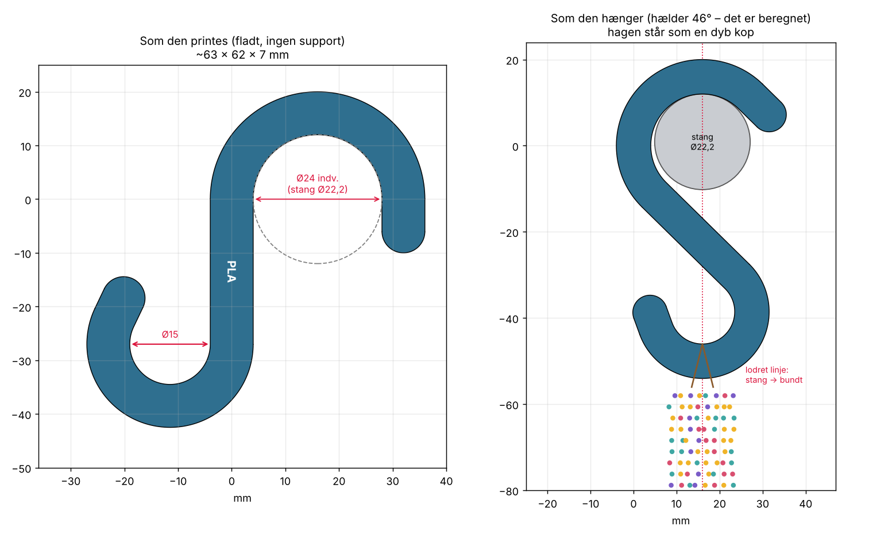

# Perle-krog (S-krog) til stativstangen

Lille S-krog i stil med IKEA's, lavet til vores stativstang (**Ø 22,2 mm**, målt med skydelære).
Den store top-krog går om stangen, og den lille hage forneden holder perlebundterne.

Der er **to varianter**:

- **PETG (standard):** lille og let, til op til ca. 2 kg.
- **PLA (forstærket):** bredere og tykkere, til op til ca. **4 kg**. Den har **"PLA" præget i skaftet**,
  så man altid kan se, hvilket materiale krogen er lavet af.

---

## Nøgletal

| | PETG (standard) | PLA (forstærket) |
|---|---|---|
| Fil | `perle_krog.stl` | `perle_krog_PLA.stl` |
| Størrelse | 54 × 55 × 6 mm | 63 × 63 × 7 mm |
| Profil (bredde × tykkelse) | 5 × 6 mm | 8 × 7 mm |
| Top-krog (om stangen) | Ø 24 mm indv. | Ø 24 mm indv. |
| Hage (til bundter) | Ø 15 mm, åbning 12,5 mm | Ø 15 mm, åbning 12,2 mm |
| Mærke | ingen | "PLA" præget 0,6 mm ned i skaftet |
| Vægt | ca. 4 g | ca. 6,7 g |
| Printtid (MK4S, 0,20 mm SPEED) | ca. 8 min | ca. 13 min |
| Pris i filament | ca. 1 kr. | ca. 1 kr. |
| Brud (beregnet) | ca. 5 kg | ca. 15 kg |
| **Hæng max** | **ca. 2 kg** | **ca. 4 kg** |

Top-krogen har 1,8 mm luft om stangen i begge varianter, så den er let at hænge på og tage af.
Åbningen ind i hagen er 12–12,5 mm, ligesom butikkens metal-kroge (målt 12,4–12,6 mm).
IKEA's krog er til sammenligning 60 mm høj og må bære 4 kg.

### Hvorfor er PLA-krogen bygget så kraftigt?

PLA er stærkt, men det **kryber**: under konstant belastning giver det langsomt efter over uger og
måneder, især når det er varmt. Derfor er PLA-krogen dimensioneret, så den ved 4 kg kun bliver
belastet med ca. 1/4 af det, den kan holde til på kort sigt. Styrken stiger med bredden i anden potens,
så det er mest bredden (5 → 8 mm), der er øget. Det giver mest styrke for mindst plastik.

Mærket sidder midt på skaftet, hvor krogen er mindst belastet, så det ikke svækker den.

## Det smarte: hagen er "hældnings-kompenseret"

En S-krog hænger altid skævt: stangens centrum og hagens centrum lægger sig lodret under
hinanden (se højre billede). Det gør, at en almindelig S-krogs nederste hage bliver drejet, så
bundterne lettere glider af. Modellen regner selv hældningen ud (ca. 44–46°) og lader hagen bue
ekstra rundt. Når krogen hænger, står hagen derfor som en dyb kop med spidsen pegende lige op.

---

## Filer

| Fil | Hvad |
|-----|------|
| `perle_krog.stl` | PETG-varianten, klar til print. 1 krog, ligger fladt. |
| `perle_krog_PLA.stl` | PLA-varianten (forstærket, med "PLA"-mærke), klar til print. |
| `perle_krog.scad` | Modellen (OpenSCAD). Vælg `variant` øverst i filen. Alle mål kan ændres der. |
| `print/` | Klar-til-print PrusaSlicer-projekter (3MF) med indstillinger. |
| `renders/` | Preview-billeder. |

---

## Klar til print: PLA på MK4S (åbn og print)

PrusaSlicer-projekt med krogen placeret midt på pladen og alle indstillinger gemt i filen:

| Fil | Indhold | Tid | Filament |
|---|---|---|---|
| `print/perle_krog_PLA_MK4S_1stk.3mf` | 1 krog | ca. 13 min | 6,7 g |
| `print/perle_krog_PLA_MK4S_18stk.3mf` | fuld plade, 18 stk (max) | ca. 4 t | ca. 120 g |

Den fulde plade er det højeste antal, der kan være på pladen med mindst ca. 3 mm luft mellem
krogene (alle drejet ens og lagt skråt, så de griber ind i hinanden).

**Indstillinger i filerne:**

- Printer: `Original Prusa MK4S 0.4 nozzle`
- Print: `0.20mm SPEED @MK4S 0.4`
- Filament: `Generic PLA` (220 °C, første lag 230 °C, bed 60 °C), som passer til Sunlu PLA
- **5 perimetre, 4 top- og 4 bundlag.** De er sat direkte på krogen, så de bliver,
  selvom man skifter print- eller filamentprofil.

**Sådan:** Åbn filen i PrusaSlicer (Fil → Åbn projekt). Spørger den, om indstillingerne fra projektet
skal indlæses, så svar ja. Tryk **Slice** og send til printeren.
Har I en High-Flow-dyse, så vælg printerprofilen `MK4S HF0.4`. Krog-indstillingerne følger med.

Tiderne er beregnet med PrusaSlicer og er uden opvarmning og bed-måling (ca. 3–5 min ekstra).

---

## Print (Prusa MK4S)

- **Orientering:** fladt, som STL'en ligger. **Ingen support.** Så følger laglinjerne krogens
  form, og belastningen går *langs* perimetrene. Det er den stærkeste måde at printe en krog på.
- **Profil:** `0.20mm SPEED`
- **Perimetre: 5.** Det er det vigtigste, fordi krogen så bliver massiv. Infill er ligegyldigt.
- **Top/bund:** 4 lag
- **Brim:** ikke nødvendigt
- **Mange på én gang:** marker krogen i PrusaSlicer, tryk **+** for flere kopier og **A** for at arrangere.
  Der kan sagtens ligge 20–30 på pladen.
- **Temperatur:** PETG ca. 230–240 °C / bed 85 °C. Sunlu PLA ca. 210 °C / bed 60 °C
  (PrusaSlicer-profilen `Generic PLA` passer fint).

### Materiale

- **PETG** er sejt. Overbelastes den, bøjer den, før den knækker, og den kryber mindre end PLA
  ved konstant belastning. Det er det bedste til kroge, der hænger med vægt hele tiden.
- **PLA:** brug **altid PLA-varianten** (`perle_krog_PLA.stl`). Print aldrig PETG-varianten i PLA,
  for den er for tynd til PLA ved konstant belastning. PLA er sprødt og knækker uden varsel, og det
  bliver blødt ved ca. 55 °C. Undgå derfor steder med direkte sol, fx et butiksvindue om sommeren.

### Test først

Print 2–3 stk af den variant, I skal bruge, og hæng **dobbelt last** på én test-krog i et døgn:
**4 kg** på PETG-krogen eller **8 kg** på PLA-krogen (fx en pose perler eller vandflasker).
Holder den uden at åbne sig synligt, er I godt dækket ind. Brug ikke test-krogen bagefter.

---

## Justering (i `perle_krog.scad`)

| Parameter | PETG / PLA | Hvad |
|---|---|---|
| `variant` | `"PETG"` | Vælg `"PETG"` eller `"PLA"`. Sætter `wall`, `thick`, `shank` og `label`. |
| `rod_d` | 22,2 | Stangens diameter. Mål en anden stang og skriv tallet her. |
| `rod_clearance` | 1,8 | Luft om stangen. Mindre = sidder strammere. |
| `wall` | 5 / 8 | Godsbredde. Styrken stiger med bredden i anden potens. |
| `thick` | 6 / 7 | Krogens tykkelse (printhøjde). Styrken stiger lineært. |
| `shank` | 25 / 27 | Skaftets længde. Længere = hænger mere lodret, lidt mere plastik. |
| `hook_d` | 15 | Hagens indvendige Ø. Større = bredere åbning (konsollen viser åbningen). |
| `top_tip` | 6 | Top-spidsens længde. Længere = falder sværere af stangen. |
| `label` | `""` / `"PLA"` | Tekst præget i skaftet. Fx `"PETG"`, hvis PETG-krogene også skal mærkes. |

Åbn filen i OpenSCAD, ret tallet, tryk **F6** (render) og **F7** (eksportér STL).
Fra kommandolinjen: `openscad -D 'variant="PLA"' -o perle_krog_PLA.stl perle_krog.scad`.
Konsollen viser hældning og åbninger, så du kan se, at stangen stadig kan komme ind.
