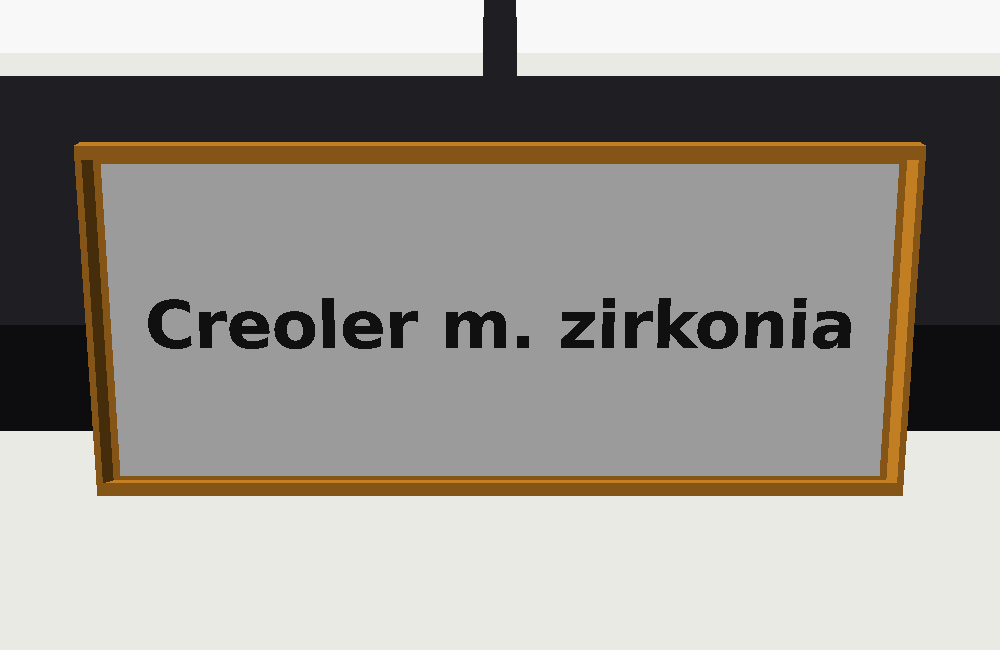
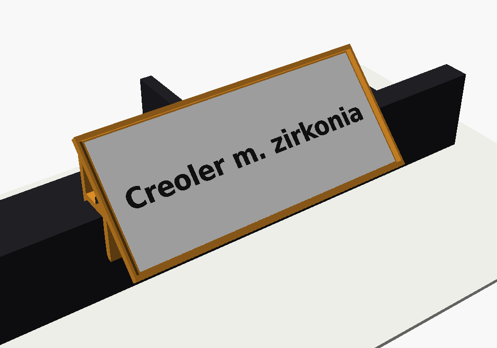
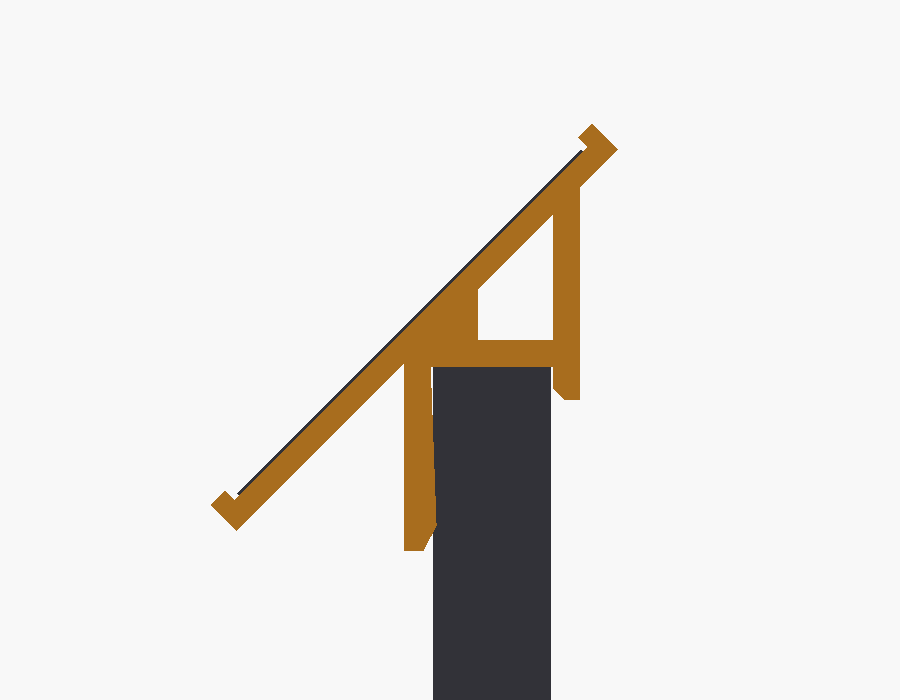
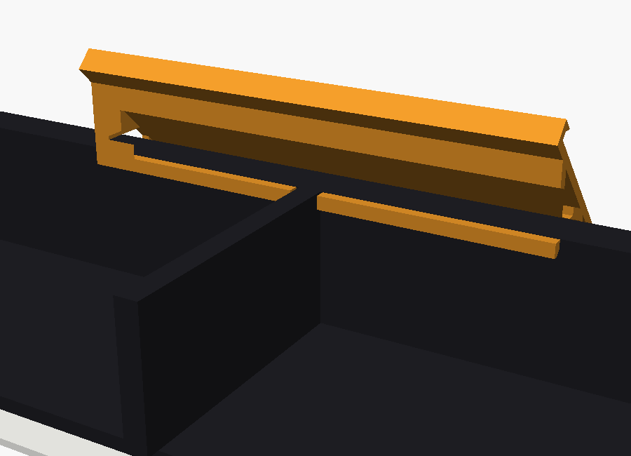
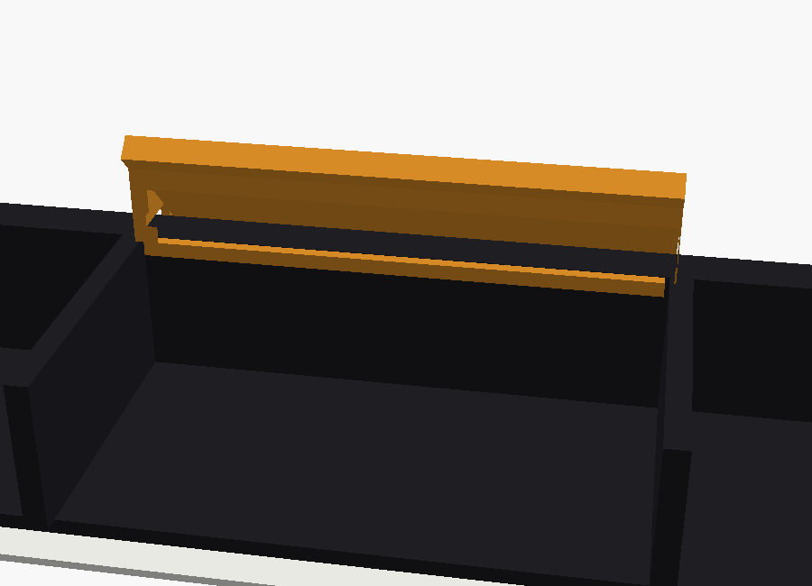
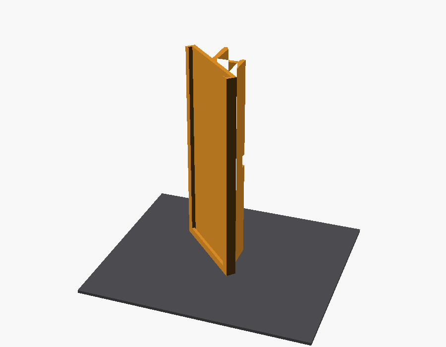
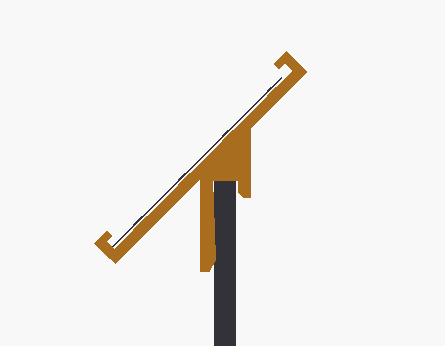

# Skilteholder til bakker (Prusa MK4S)

En meget billig skilteholder, der **hænger på forkanten af en bakke**. Den holder
et **label på 70 × 29 mm** i et labelvindue, der **hælder 45°** mod kunden. Så kan man læse
den næsten lige forfra, når man står ved bordet og kigger ned.

Labelen sidder **centreret på bakkens forkant**: halvdelen foran kanten og halvdelen over.
Holderen rager derfor kun ~15 mm op over kanten.

**Intet går ned i rummene.** Holderen hviler oven på kanten. Benet går ned på
*ydersiden* af kanten, og på indersiden er der kun en lille **krog på 2 mm**, der griber
kantens øverste inderkant. Rummene (ca. 3 cm dybe) og varerne i dem er helt fri.

| | |
|---|---|
|  |  |
| *Hængt på bakke A* | *Snit: yderben udvendigt, 2 mm krog indvendigt, labellomme i 45°* |

**Pris:** ca. **9 g PLA** pr. stk. (≈ 1 kr. i filament). Ingen support, skruer eller lim.

---

## Mål fra billederne

| Bakke | Billede | Kantens tykkelse | Andet | Krogen på indersiden |
|-------|---------|------------------|-------|----------------------|
| **A**, velourbakke | 1–3 | **7,0 mm** | rum 56,2 mm, skillevæg **3,4 mm** | **udskæring over midter-skillevæggen**, så skiltet centreres på bakkens midte |
| **B**, plastkurv | 4 | **2,7 mm** | – | fuld bredde |
| **C**, velourbakke | 5 | **7,0 mm** | rum **71,2 mm** | gjort smallere (70,0 mm), så den **passer mellem skillevæggene i ét rum**. Skiltet centreres på rummet, og der kan sidde ét skilt pr. rum |

Alle kanter er ca. 20 mm høje. Yderbenet går 11 mm ned *uden på* kanten. Krogen går kun 2 mm
ned på indersiden.

| Bakke A: rummene er fri, krogen har udskæring over skillevæggen | Bakke C: krogen passer i ét rum |
|---|---|
|  |  |

---

## Filer

| Fil | Til |
|-----|-----|
| `prusa_projekter/skilteholder_A_1stk_test.3mf` | **Testprint**: 1 stk. til bakke A, midt på pladen (~54 min, 9 g) |
| `prusa_projekter/skilteholder_B_1stk_test.3mf` | Testprint: 1 stk. til bakke B (~52 min, 8 g) |
| `prusa_projekter/skilteholder_C_1stk_test.3mf` | Testprint: 1 stk. til bakke C (~54 min, 9 g) |
| `prusa_projekter/skilteholder_A_16stk.3mf` | **Færdigt PrusaSlicer-projekt**: 16 stk. til bakke A på én plade |
| `prusa_projekter/skilteholder_B_16stk.3mf` | Færdigt projekt: 16 stk. til bakke B |
| `prusa_projekter/skilteholder_C_16stk.3mf` | Færdigt projekt: 16 stk. til bakke C |
| `skilteholder_A_velourbakke_7mm_skillevaeg.stl` | Bakke A (billede 1–3) |
| `skilteholder_B_plastkurv_2-7mm.stl` | Bakke B (billede 4) |
| `skilteholder_C_velourbakke_7mm_rum71.stl` | Bakke C (billede 5) |
| `skilteholder.scad` | Den parametriske model. Alle mål ændres her |
| `renders/` | Preview-billeder |

### Projektfilerne (.3mf): åbn og print
Åbn en `.3mf` i PrusaSlicer (dobbeltklik, eller *Fil → Åbn projekt*). Så ligger 16 holdere klar
på pladen, og indstillingerne sidder på selve objektet:
- brim 5 mm (outer only, 0,1 mm separation)
- 2 perimetre og 15 % infill
- ingen support og 0,20 mm lag

Filen indeholder **ingen printerprofil**, så PrusaSlicer bruger den printer og det filament, du
allerede har valgt. Vælg **Original Prusa MK4S** og dit PLA, og tryk *Slice*. Vil du have
færre/flere, så højreklik på objektet → *Sæt antal instanser*.

STL-filerne er også drejet til print, hvis du hellere vil sætte det op selv.

**Mål:** 71,8 mm bred. Holderen rager **~15 mm op** over kanten og **~14 mm frem** foran
kanten. Den går 11 mm ned på *ydersiden*, så der er ~9 mm luft til bordet. Bakken skal altså
have ~15 mm fri plads foran sig. Det er der, når den står ved bordkanten, som på billederne.

---

## Labelen

- Labelen (70 × 29 mm) **skubbes ind fra venstre side** set forfra. Den højre ende er lukket og virker som stop.
- Lommen er 1,0 mm dyb. Der er plads til papir-label + evt. et stykke tynd klar plastfolie foran.
- Rammen overlapper labelens kant med 1,5 mm. Det synlige felt er ca. **69 × 26,6 mm**. Hold teksten lidt fra kanten.
- **Bakke C med skilte side om side:** Der er kun få mm mellem nabo-holderne. Sæt derfor labelen i,
  *før* holderen sættes på (eller tag den af for at skifte label).

---

## Print på Prusa MK4S

Holderen printes **stående på den lukkede ende**. Så ligger hele profilen i printplanet:
- **ingen support** (udskæringerne har 45°-skrå "tage", så de kan printes frit)
- benet fjedrer *langs* laglinjerne og knækker ikke
- labelvinduet og krogen bliver målfaste

**Indstillinger:**

| | |
|---|---|
| Materiale | **PLA** er fint. Ingen varme her. **Sort** matcher bakkerne |
| Profil | 0,20 mm SPEED |
| Perimetre | 2 (væggene er 1–1,6 mm, så det hele bliver alligevel massivt) |
| Infill | 15 % (betyder næsten intet her) |
| Support | **Ingen** |
| **Brim** | **5 mm**, *Outer brim only*, *Brim separation gap* 0,1 mm. Delen er 72 mm høj på en lille flade. Uden brim advarer PrusaSlicer om "Low bed adhesion". Pil brimmen af ved benet og krogen |
| Flere ad gangen | Højreklik → *Sæt antal instanser* → 16 → **A** (arrangér) |

**Tid og forbrug** (sliced i PrusaSlicer med MK4 Input Shaper-profilen. MK4S er lidt hurtigere):

| | Tid | Filament |
|---|---|---|
| 1 stk. | ~54 min | 9,3 g |
| **16 stk. på én plade (A eller C)** | **~7 t 50 min** (et natprint) | 147 g |
| 16 stk. på én plade (B) | ~6 t 20 min | 123 g |

Tykkere lag (0,28 mm) sparer kun ~10 % tid. Printet er begrænset af flowet, ikke af antal lag.
Så hold jer til 0,20 mm.

---

## Prøv først én

Print **én holder** (`..._1stk_test.3mf`) og prøv den på bakken, før I printer en hel plade:

- **Slingrer / sidder for løst** → sæt `grip` op fra 0,4 til 0,6–0,8.
- **For stram / svær at sætte på** → sæt `grip` ned til 0,2, eller `fit` op til 0,5.
- **Udskæringen (A) rammer skillevæggen** → sæt `div_clear` op fra 0,8 til 1,2.
- **Krogen (C) går ikke ned mellem skillevæggene** → sæt `comp_clear` op fra 1,2 til 2,0.
- **Vil du have den til at sidde fastere**, så gør krogen længere med `inner_lip` (fx 4). Så går den
  til gengæld lidt længere ned i rummet.

Holderen hænger mest ved sin egen vægt. Tyngdepunktet ligger lige over/foran kanten, så den
vipper ikke ind i bakken. Den kan løftes af med én hånd.

---

## Tilpas (OpenSCAD)

Åbn `skilteholder.scad` i OpenSCAD. Vælg bakke øverst (`bakke = "A"`, `"B"`, `"C"` eller `"custom"`).
Tryk **F5** for preview. Sæt `show_tray = true` for at se bakke + label, og `section = true` for
profilen. Eksportér så med `print_ready = true` → **F6** → **F7**. Konsollen skriver de vigtigste
mål (højde, hvor langt den rager frem osv.).

| Parameter | Betydning | Default |
|-----------|-----------|---------|
| `bakke` | Vælger mål for A/B/C. `"custom"` bruger tallene herunder | `"A"` |
| `custom_rim` | Kantens tykkelse | 7,0 |
| `custom_divider` | Tykkelse på skillevæg der skal være udskæring over (0 = ingen) | 0 |
| `custom_compartment` | Rum-bredde krogen skal passe ned i (0 = fuld bredde) | 0 |
| `label_w` / `label_h` | Labelens mål | 70 / 29 |
| `label_angle` | Hældning fra **vandret**. 35 = fladere, 55 = mere oprejst | 45 |
| `front_frac` | Hvor meget af labelen der sidder foran kanten. **0,5** = centreret på kanten. **0** = hele labelen oppe over bakken (rager 0 mm frem, men 27 mm op og 14 mm ind over bakken). Brug 0, hvis bakkerne står helt tæt | 0,5 |
| `label_gap` | Lommens dybde (papir + evt. folie) | 1,0 |
| `grip` / `fit` | Hvor tæt den sidder / luft ved roden | 0,4 / 0,3 |
| `leg_len` | Hvor langt yderbenet går ned *uden på* kanten | 11 |
| `inner_lip` | Hvor langt krogen går ned på *indersiden* (ind i rummet). 0 = ingen krog | 2 |

**Ny bakke?** Mål kantens tykkelse (og evt. skillevæg/rum). Sæt `bakke = "custom"` og
`custom_*`, og eksportér en ny STL.

### Hvorfor 45°?
Står kunden tæt ved bordet, kigger man ca. 60–70° ned. Står man 1–1,5 m væk, er det kun ca. 30°.
45° ligger midt imellem, så labelen er læsbar fra begge afstande (højst ~25° skævt).

*Snit af B-varianten på den tynde plastkant (2,7 mm)*
